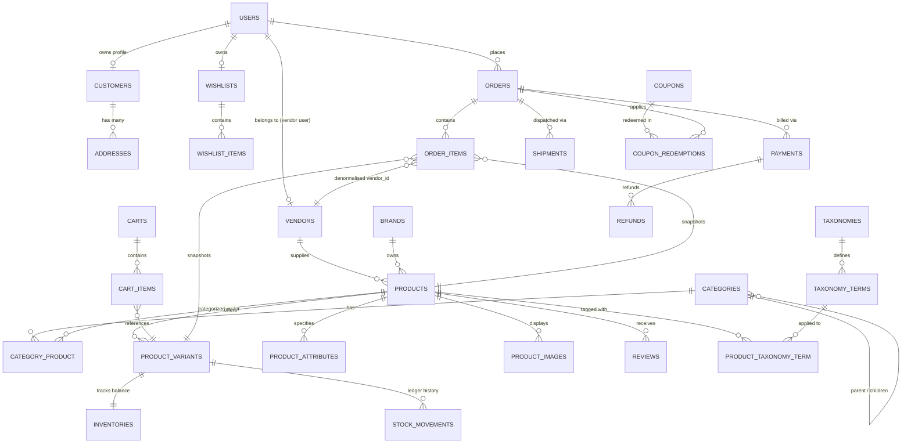

# Henley Database Schema & Architecture Reference

This document provides a comprehensive table-by-table reference and Entity-Relationship (ER) specification for Henley's PostgreSQL domain model.

---

## 1. Core Commerce Entity-Relationship Diagram

---

## 2. Table-by-Table Reference

### Identity, Access & Profiles

#### `users`
Central authentication and identity table serving all three audiences (Super Admins, Admins, Vendor Partners, Customers).
- `id` (bigint, PK)
- `name` (string)
- `email` (string, unique)
- `phone` (string, unique, nullable)
- `email_verified_at` (timestampTz, nullable)
- `password` (string)
- `role` (string enum: `super_admin`, `admin`, `vendor`, `customer`)
- `vendor_id` (bigint, nullable, FK -> `vendors.id`)
- `is_active` (boolean, default `true`)
- `remember_token` (string, nullable)
- `created_at`, `updated_at` (timestampTz)
- **Indexes**: `role`, `vendor_id`, `is_active`.

#### `customers`
1-to-1 extension of customer shoppers storing preferences and biographical details.
- `id` (bigint, PK)
- `user_id` (bigint, unique, FK -> `users.id`)
- `date_of_birth` (date, nullable)
- `gender` (string, nullable)
- `avatar_url` (string, nullable)
- `preferences` (jsonb, nullable)
- `notes` (text, nullable)
- `created_at`, `updated_at` (timestampTz)

#### `addresses`
Customer-owned multi-address book for shipping and billing.
- `id` (bigint, PK)
- `customer_id` (bigint, FK -> `customers.id`)
- `recipient_name` (string)
- `phone` (string)
- `line_1` (string)
- `line_2` (string, nullable)
- `landmark` (string, nullable)
- `city` (string)
- `state` (string)
- `pincode` (string, indexed)
- `country` (string, default `'IN'`)
- `type` (string enum: `home`, `work`, `other`)
- `is_default_shipping` (boolean, default `false`)
- `is_default_billing` (boolean, default `false`)
- `latitude` (decimal(10,7), nullable)
- `longitude` (decimal(10,7), nullable)
- `created_at`, `updated_at` (timestampTz)
- **Indexes**: `[customer_id, is_default_shipping]`, `[customer_id, is_default_billing]`.

#### `vendors`
Approved estate producers and botanical suppliers.
- `id` (bigint, PK)
- `business_name` (string)
- `legal_name` (string, nullable)
- `slug` (string, unique)
- `gstin` (string, nullable, indexed)
- `email` (string, unique)
- `phone` (string, nullable)
- `address` (jsonb, nullable)
- `commission_rate` (decimal(5,2), default `15.00`)
- `status` (string enum: `pending`, `approved`, `suspended`, `rejected`)
- `approved_at` (timestampTz, nullable)
- `bank_details` (jsonb, nullable)
- `notes` (text, nullable)
- `created_at`, `updated_at`, `deleted_at` (timestampTz)
- **Indexes**: `[status, created_at]`.

#### `otp_codes`
Time-based verification codes for passwordless authentication and password resets.
- `id` (bigint, PK)
- `identifier` (string, indexed)
- `code` (string)
- `type` (string: `login`, `password_reset`, `verification`)
- `expires_at` (timestampTz)
- `verified_at` (timestampTz, nullable)
- `attempts` (smallint, default `0`)
- `created_at`, `updated_at` (timestampTz)

---

### Catalogue & Facet Filtering

#### `categories`
Self-referencing hierarchical collections (e.g. `Restorative Sleep`, `Heritage Black`).
- `id` (bigint, PK)
- `parent_id` (bigint, nullable, FK -> `categories.id`)
- `name` (string)
- `slug` (string, unique)
- `description` (text, nullable)
- `sort_order` (integer, default `0`)
- `is_featured` (boolean, default `false`)
- `image_path` (string, nullable)
- `seo_title`, `seo_description` (text, nullable)
- `created_at`, `updated_at`, `deleted_at` (timestampTz)

#### `brands`
Brand entities representing private reserve lines and sub-labels.
- `id` (bigint, PK)
- `name` (string)
- `slug` (string, unique)
- `logo_path` (string, nullable)
- `description` (text, nullable)
- `website_url` (string, nullable)
- `is_featured` (boolean, default `false`)
- `seo_title`, `seo_description` (text, nullable)
- `created_at`, `updated_at`, `deleted_at` (timestampTz)

#### `products`
The core luxury botanical SKU master table with PostgreSQL Full-Text Search.
- `id` (bigint, PK)
- `vendor_id` (bigint, nullable, FK -> `vendors.id`)
- `brand_id` (bigint, nullable, FK -> `brands.id`)
- `name` (string)
- `slug` (string, unique)
- `short_description` (text, nullable)
- `description` (text)
- `ingredients` (text, nullable)
- `brewing_guide` (text, nullable)
- `status` (string enum: `draft`, `published`, `archived`)
- `is_featured` (boolean, default `false`)
- `is_bestseller` (boolean, default `false`)
- `base_price` (decimal(12,2))
- `compare_at_price` (decimal(12,2), nullable)
- `tax_rate_percent` (decimal(5,2), default `5.00`)
- `weight_grams` (integer, nullable)
- `dimensions` (jsonb, nullable: length, width, height)
- `rating_average` (decimal(3,2), default `0.00`)
- `rating_count` (unsigned integer, default `0`)
- `published_at` (timestampTz, nullable)
- `seo_title`, `seo_description` (text, nullable)
- `metadata` (jsonb, nullable)
- `search_vector` (tsvector generated always as weighted title, short desc, desc, ingredients)
- `created_at`, `updated_at`, `deleted_at` (timestampTz)
- **Indexes**: `[vendor_id, status]`, `[status, published_at]`, `[status, is_featured]`, `[status, is_bestseller]`, GIN on `search_vector`.

#### `product_variants`
Size and packaging variations (e.g. 100g Porcelain Cloche Jar, 250g Botanical Refill Pouch).
- `id` (bigint, PK)
- `product_id` (bigint, FK -> `products.id`)
- `sku` (string, unique)
- `option_label` (string)
- `price` (decimal(12,2))
- `compare_at_price` (decimal(12,2), nullable)
- `weight_grams` (integer)
- `barcode` (string, nullable, indexed)
- `sort_order` (integer, default `0`)
- `is_active` (boolean, default `true`)
- `created_at`, `updated_at` (timestampTz)
- **Indexes**: `[product_id, is_active, sort_order]`.

#### `taxonomies`, `taxonomy_terms` & `product_taxonomy_term`
Optimized facet system allowing single-query facet counts across benefits (`Sleep`, `Immunity`), types (`Green`, `Herbal`, `Black`), and caffeine profiles.

---

### Inventory & Stock Movement Ledger

#### `inventories`
Active inventory balance per variant.
- `id` (bigint, PK)
- `product_variant_id` (bigint, unique, FK -> `product_variants.id`)
- `quantity_on_hand` (integer, default `0`)
- `quantity_reserved` (integer, default `0`)
- `low_stock_threshold` (integer, default `5`)
- `warehouse_location` (string, nullable)
- `created_at`, `updated_at` (timestampTz)

#### `stock_movements`
Immutable, append-only stock audit ledger.
- `id` (bigint, PK)
- `product_variant_id` (bigint, FK -> `product_variants.id`)
- `reason` (string enum: `initial_stock`, `order_placed`, `order_cancelled`, `restock`, `manual_adjustment`, `damaged`, `return_restock`)
- `quantity_delta` (integer)
- `balance_after` (integer)
- `actor_id` (bigint, nullable, FK -> `users.id`)
- `reference_type` (string, nullable)
- `reference_id` (string, nullable)
- `notes` (text, nullable)
- `created_at` (timestampTz)
- **Indexes**: `[product_variant_id, created_at]`, `reason`.

---

### Commerce, Orders & Payments

#### `carts` & `cart_items`
Persistent shopper cart supporting guest session tokens and seamless merge on authentication.

#### `orders`
Immutable financial record storing full JSONB snapshots of customer, shipping, and billing data at the moment of checkout.
- `id` (bigint, PK)
- `order_number` (string, unique, e.g. `HNL-2026-1042`)
- `user_id` (bigint, nullable, FK -> `users.id`)
- `customer_id` (bigint, nullable, FK -> `customers.id`)
- `customer_snapshot` (jsonb)
- `shipping_address` (jsonb)
- `billing_address` (jsonb)
- `subtotal` (decimal(12,2))
- `discount_amount` (decimal(12,2), default `0.00`)
- `tax_amount` (decimal(12,2), default `0.00`)
- `shipping_amount` (decimal(12,2), default `0.00`)
- `grand_total` (decimal(12,2))
- `coupon_id` (bigint, nullable, FK -> `coupons.id`)
- `status` (string enum: `pending`, `confirmed`, `processing`, `shipped`, `delivered`, `cancelled`, `refunded`)
- `payment_status` (string enum: `pending`, `authorized`, `captured`, `failed`, `refunded`)
- `currency` (string(3), default `'INR'`)
- `placed_at` (timestampTz)
- `fulfilled_at`, `cancelled_at` (timestampTz, nullable)
- `customer_notes`, `admin_notes` (text, nullable)
- `created_at`, `updated_at` (timestampTz)

#### `order_items`
Line-item snapshot with denormalised `vendor_id` for zero-join vendor scoping.
- `id` (bigint, PK)
- `order_id` (bigint, FK -> `orders.id`)
- `product_id` (bigint, nullable, FK -> `products.id`)
- `product_variant_id` (bigint, nullable, FK -> `product_variants.id`)
- `vendor_id` (bigint, nullable, FK -> `vendors.id`, indexed)
- `product_name` (string)
- `variant_label` (string)
- `sku` (string)
- `unit_price` (decimal(12,2))
- `quantity` (unsigned integer)
- `line_tax`, `line_discount`, `line_total` (decimal(12,2))
- `created_at`, `updated_at` (timestampTz)
- **Indexes**: `[vendor_id, order_id]`, `[order_id, product_id]`.

#### `payments`, `refunds` & `shipments`
- Gateway callback records (Razorpay payload JSONB, transaction IDs, signatures).
- Gateway refund references and reasons.
- Courier tracking details (BlueDart, Delhivery, tracking URLs, delivery timestamps).

---

### Promotions, Editorial & Customer Engagement

#### `coupons` & `coupon_redemptions`
- Configurable discounts (`percentage`, `fixed`, `free_shipping`) with min order value, max discount cap, total and per-customer redemption tracking.

#### `reviews`
- Verified star ratings (1 to 5) with automated denormalised average and count computation on `products`.

#### `cms_pages`, `homepage_sections`, `banners`, `journal_posts`
- Dynamic JSONB section payloads for CMS-driven storefront composition and botanical journal editorial essays.

#### `settings`
- Typed key-value configurations for global business parameters (`free_shipping_threshold_paise`, `default_gst_rate_percent`).
